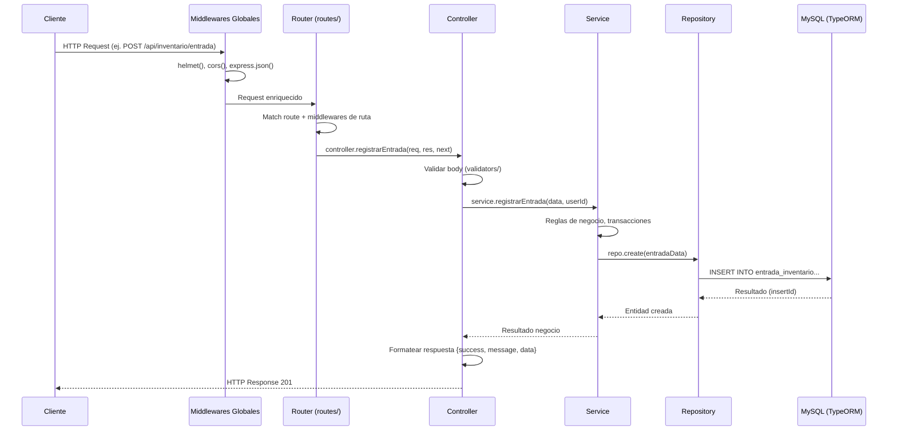

# Arquitectura y Ciclo de Vida de la API

## Visión General

El backend sigue una **arquitectura por capas** (Layered Architecture) con separación de responsabilidades:

```
src/
├── config/         → Configuración (DataSource TypeORM, env)
├── routes/         → Definición de endpoints (sin lógica)
├── controllers/    → Capa HTTP: req/res, validación entrada, respuesta
├── services/       → Lógica de negocio y orquestación
├── repositories/   → Acceso a datos (TypeORM Repository pattern)
├── entities/       → Esquemas TypeORM (mapeo tablas MySQL)
├── middlewares/    → Transversales: auth, errores, logging
├── validators/     → Validación de entrada (Joi/Zod)
└── utils/          → Helpers compartidos
```

---

## Ciclo de Vida de una Petición HTTP



---

## Flujo Detallado por Capa

### 1. **Middlewares Globales** (`app.js:17-20`)
- `helmet()` — Headers de seguridad
- `cors()` — Cross-Origin Resource Sharing
- `express.json()` — Parse JSON body
- `express.urlencoded()` — Parse form data

### 2. **Router** (`app.js:22-27`)
- Prefijo `/api`
- Delega a routers modulares: `auth`, `categorias`, `productos`, `inventario`, `usuarios`

### 3. **Middlewares de Ruta** (ej. `inventario.routes.js:14-19`)
```javascript
router.post('/entrada', verificarToken, autorizarRoles(1, 3), controller.registrarEntrada);
```
- `verificarToken` → Valida JWT, setea `req.usuario` (401 si falla)
- `autorizarRoles(1, 3)` → Solo Admin(1) o Cajero(3) (403 si falla)

### 4. **Controller** (`inventario.controller.js`)
```javascript
async registrarEntrada(req, res, next) {
  try {
    const data = req.body;
    const userId = req.usuario.id_usuario; // del JWT
    const entrada = await inventarioService.registrarEntrada(data, userId);
    res.status(201).json({ success: true, message: 'Entrada registrada', data: entrada });
  } catch (err) { next(err); }
}
```
- Recibe `req`, `res`, `next`
- Extrae/valida datos de entrada
- Llama al Service
- Formatea respuesta estándar: `{ success, message, data }`
- Delega errores a `next(err)` → middleware de errores

### 5. **Service** (`inventario.service.js`)
```javascript
async registrarEntrada(data, userId) {
  // Reglas de negocio: validar stock, producto existe, etc.
  const entrada = await inventarioRepository.create({ ...data, creado_por: userId });
  // Trigger BD actualiza stock automáticamente
  return entrada;
}
```
- Lógica de negocio pura (sin HTTP)
- Orquesta repositorios
- Maneja transacciones si aplica
- Lanza errores de negocio (HttpError)

### 6. **Repository** (`inventario.repository.js`)
```javascript
async create(data) {
  const repo = dataSource.getRepository(EntradaInventario);
  const entity = repo.create(data);
  return await repo.save(entity);
}
```
- Abstracción de acceso a datos
- Usa TypeORM `Repository` / `EntityManager`
- Consultas complejas, joins, transacciones

### 7. **Base de Datos** (MySQL + Triggers)
- `entrada_inventario` → Trigger `trg_entrada_actualiza_stock` actualiza `inventario.stock_actual`
- Triggers de auditoría en tablas críticas (ver `docs/auditoria-triggers.md`)

---

## Manejo de Errores Centralizado

```mermaid
flowchart TD
    A[Error en cualquier capa] --> B{next(err)}
    B --> C[error.middleware.js]
    C --> D{HttpError?}
    D -->|Sí| E[statusCode + message del error]
    D -->|No| F[500 Internal Server Error]
    E --> G[Respuesta JSON estandarizada]
    F --> G
    G --> H[Cliente recibe {success:false, message, ...}]
```

Formato de respuesta de error:
```json
{
  "success": false,
  "message": "No se proporcionó el token de autenticación",
  "statusCode": 401
}
```

---

## Ejemplo Completo: `POST /api/inventario/entrada`

| Paso | Archivo | Responsabilidad |
|------|---------|-----------------|
| 1 | `app.js` | Middlewares globales |
| 2 | `inventario.routes.js:14-19` | Auth + RBAC (Admin/Cajero) |
| 3 | `inventario.validator.js` | Validar `producto_id`, `cantidad > 0` |
| 4 | `inventario.controller.js` | Orquestar request → service → response |
| 5 | `inventario.service.js` | Validar producto existe, crear entrada |
| 6 | `inventario.repository.js` | `INSERT entrada_inventario` |
| 7 | MySQL Trigger | `UPDATE inventario SET stock_actual = stock_actual + NEW.cantidad` |
| 8 | MySQL Trigger | `INSERT INTO auditoria ...` |
| 9 | Controller | `res.status(201).json({success:true, data:entrada})` |

---

## Ventajas de esta Arquitectura

| Capa | Beneficio |
|------|-----------|
| **Routes** | Contrato de API visible, sin lógica |
| **Controllers** | Delgados, solo HTTP ↔ App |
| **Services** | Reutilizables, testeables, transaccionales |
| **Repositories** | Swappable ORM, queries optimizadas |
| **Entities** | Single source of truth del esquema |
| **Middlewares** | Cross-cutting concerns (auth, errors, logging) |