# Modelado de Datos y Relaciones

## Diagrama ER Simplificado (Núcleo del Sistema)

```mermaid
erDiagram
    ROLES ||--o{ USUARIOS : "1:N"
    USUARIOS ||--o{ USUARIOS : "creado_por (1:N recursiva)"
    USUARIOS ||--o{ CAJA : "cajero_id (1:N)"
    USUARIOS ||--o{ FACTURAS_VENTAS : "cajero_id (1:N)"
    USUARIOS ||--o{ ENTRADA_INVENTARIO : "creado_por (1:N)"
    USUARIOS ||--o{ ORDENES_COMPRA : "usuario_id (1:N)"
    USUARIOS ||--o{ DEVOLUCIONES : "cajero_id (1:N)"
    USUARIOS ||--o{ AUDITORIA : "usuario_id (1:N)"
    USUARIOS ||--o{ ANOMALIAS : "usuario_id (1:N)"
    
    CATEGORIAS ||--o{ PRODUCTOS : "1:N"
    UNIDADES_MEDIDA ||--o{ PRODUCTOS : "1:N"
    PRODUCTOS ||--o{ IMG_PRODUCTOS : "1:N"
    PRODUCTOS ||--o{ INVENTARIO : "1:1"
    PRODUCTOS }|--o{ PROVEEDOR_PRODUCTO : "N:M"
    PROVEEDORES }|--o{ PROVEEDOR_PRODUCTO : "N:M"
    PRODUCTOS ||--o{ ITEMS_FACTURA : "1:N"
    PRODUCTOS ||--o{ ENTRADA_INVENTARIO : "1:N"
    PRODUCTOS ||--o{ ITEMS_ORDEN_COMPRA : "1:N"
    PRODUCTOS ||--o{ PROMOCION_PRODUCTO : "N:M"
    PROMOCIONES ||--o{ PROMOCION_PRODUCTO : "N:M"
    
    FACTURAS_VENTAS ||--o{ ITEMS_FACTURA : "1:N"
    FACTURAS_VENTAS }o--|| CLIENTES : "N:1 (nullable)"
    FACTURAS_VENTAS ||--o{ PAGOS_FACTURAS_VENTAS : "1:N"
    METODOS_PAGO ||--o{ PAGOS_FACTURAS_VENTAS : "1:N"
    CAJA ||--o{ FACTURAS_VENTAS : "1:N (turno_id)"
    CAJA ||--o{ MOVIMIENTOS_TURNOS : "1:N"
    TIPO_MOVIMIENTOS ||--o{ MOVIMIENTOS_TURNOS : "1:N"
    
    CLIENTES ||--o{ CLIENTES_DIRECCIONES : "1:N"
    CLIENTES ||--o{ CARRITO : "1:1"
    CLIENTES ||--o{ PEDIDOS_ONLINE : "1:N"
    CLIENTES ||--o{ RESENAS : "1:N"
    PEDIDOS_ONLINE ||--o{ DETALLE_PEDIDOS_ONLINE : "1:N"
    PEDIDOS_ONLINE ||--o{ PAGOS_ONLINE : "1:N"
    PEDIDOS_ONLINE ||--o{ ASIGNACIONES_DOMICILIARIO : "1:1"
    PEDIDOS_ONLINE ||--o{ ESTADOS_PEDIDOS_HISTORIAL : "1:N"
    USUARIOS ||--o{ ASIGNACIONES_DOMICILIARIO : "domiciliario_id (1:N)"
    USUARIOS ||--o{ ASIGNACIONES_DOMICILIARIO : "asignado_por (1:N)"
    
    PROVEEDORES ||--o{ ORDENES_COMPRA : "1:N"
    ORDENES_COMPRA ||--o{ ITEMS_ORDEN_COMPRA : "1:N"
    ENTRADA_INVENTARIO }o--|| ORDENES_COMPRA : "N:1 (nullable)"
    
    DEVOLUCIONES }o--|| FACTURAS_VENTAS : "N:1"
    DEVOLUCIONES ||--o{ ITEMS_DEVOLUCION : "1:N"
    ESTADOS_DEVOLUCIONES ||--o{ DEVOLUCIONES : "1:N"
    
    AUDITORIA }o--|| USUARIOS : "N:1 (nullable)"
    TIPO_ANOMALIAS ||--o{ ANOMALIAS : "1:N"
    ANOMALIAS }o--|| USUARIOS : "N:1 (nullable)"
    
    NOTIFICACIONES }o--|| USUARIOS : "N:1 (nullable)"
    NOTIFICACIONES }o--|| CLIENTES : "N:1 (nullable)"
```

---

## Tablas del Núcleo con Mayor Interrelación

| Tabla | FKs Salientes | Tablas Relacionadas | Rol en el Sistema |
|-------|---------------|---------------------|-------------------|
| **usuarios** | 5 (rol_id, codigo_id, created_by, cajero_id*, domiciliario_id*) | roles, codigos, usuarios (recursiva), caja, facturas_ventas, entrada_inventario, ordenes_compra, devoluciones, asignaciones_domiciliario, auditoria, anomalias, notificaciones | **Centro de seguridad y trazabilidad** |
| **productos** | 2 (id_categoria, id_unidad_de_medida) + 7 entrantes | categorias, unidades_medida, img_productos, inventario, proveedor_producto, items_factura, entrada_inventario, items_orden_compra, promocion_producto, resenas | **Entidad central de catálogo e inventario** |
| **facturas_ventas** | 3 (cajero_id, cliente_id, turno_id) + 2 entrantes | usuarios (cajero), clientes, caja, items_factura, pagos_facturas_ventas | **Núcleo transaccional (POS)** |
| **clientes** | 2 (codigo_id, registrado_por) + 5 entrantes | codigos, usuarios (registrador), clientes_direcciones, carrito, pedidos_online, resenas, notificaciones | **E-commerce y fidelización** |
| **inventario** | 1 (producto_id - unique) + 1 entrante | productos, entrada_inventario | **Stock en tiempo real** |
| **ordenes_compra** | 2 (proveedor_id, usuario_id) + 2 entrantes | proveedores, usuarios, items_orden_compra, entrada_inventario | **Compras a proveedores** |

> \* FKs implícitas en otras tablas que referencian `usuarios.id_usuario`

---

## Cardinalidades Explícitas

### **1:1 (Uno a Uno)**

| Relación | Tabla Padre | Tabla Hija | Clave | Notas |
|----------|-------------|------------|-------|-------|
| Producto ↔ Inventario | `productos` | `inventario` | `producto_id` (UNIQUE) | Cada producto tiene exactamente 1 registro de stock |
| Cliente ↔ Carrito | `clientes` | `carrito` | `cliente_id` (UNIQUE) | Carrito único por cliente |

### **1:N (Uno a Muchos)**

| Padre (1) | Hija (N) | FK en Hija | On Delete | Descripción |
|-----------|----------|------------|-----------|-------------|
| `roles` | `usuarios` | `rol_id` | RESTRICT | Un rol tiene muchos usuarios |
| `categorias` | `productos` | `id_categoria` | SET NULL | Categoría opcional en producto |
| `unidades_de_medida` | `productos` | `id_unidad_de_medida` | SET NULL | Unidad opcional |
| `usuarios` | `clientes` | `registrado_por` | SET NULL | Usuario que registró cliente |
| `usuarios` | `caja` | `cajero_id` | RESTRICT | Turnos de caja por cajero |
| `usuarios` | `facturas_ventas` | `cajero_id` | RESTRICT | Facturas emitidas por cajero |
| `usuarios` | `entrada_inventario` | `creado_por` | RESTRICT | Entradas registradas por usuario |
| `facturas_ventas` | `items_factura` | `factura_id` | CASCADE | Ítems de la factura |
| `facturas_ventas` | `pagos_facturas_ventas` | `factura_id` | CASCADE | Pagos de la factura |
| `caja` | `movimientos_turnos` | `turno_id` | CASCADE | Movimientos de caja |
| `clientes` | `clientes_direcciones` | `cliente_id` | CASCADE | Direcciones de entrega |
| `clientes` | `pedidos_online` | `cliente_id` | RESTRICT | Pedidos e-commerce |
| `pedidos_online` | `detalle_pedidos_online` | `pedido_id` | CASCADE | Líneas del pedido |
| `pedidos_online` | `pagos_online` | `pedido_id` | CASCADE | Pagos online |
| `proveedores` | `ordenes_compra` | `proveedor_id` | RESTRICT | Órdenes a proveedor |
| `ordenes_compra` | `items_orden_compra` | `orden_compra_id` | CASCADE | Líneas de orden |
| `devoluciones` | `items_devolucion` | `devolucion_id` | CASCADE | Productos devueltos |

### **N:M (Muchos a Muchos)**

| Entidad A | Entidad B | Tabla Intermedia | FKs | Descripción |
|-----------|-----------|------------------|-----|-------------|
| `productos` | `proveedores` | `proveedor_producto` | `proveedor_id`, `producto_id` (UNIQUE compuesto) | Precio por proveedor/producto |
| `productos` | `promociones` | `promociones_productos` | `producto_id`, `id_promocion` (UNIQUE compuesto) | Productos en promoción |
| `pedidos_online` | `productos` | `detalle_pedidos_online` | `pedido_id`, `producto_id` | Detalle de pedido (con attrs: cantidad, precio) |

> **Nota**: `detalle_pedidos_online` y `items_factura` son **N:M con atributos** (cantidad, precio_unitario, descuentos) — tablas de enlace enriquecidas.

---

## Decisiones de Diseño Clave

| Decisión | Justificación |
|----------|---------------|
| `inventario.producto_id` **UNIQUE** | Garantiza 1:1 producto-stock; evita duplicados |
| `usuarios.rol_id` **NOT NULL + FK** | Todo usuario debe tener rol válido (RI) |
| `facturas_ventas.cliente_id` **NULLABLE** | Ventas de mostrador sin cliente registrado |
| `entrada_inventario.orden_compra_id` **NULLABLE** | Entradas sin OC (ej. ajuste, donación) |
| `onDelete: CASCADE` en hijas transaccionales | Borrado en cascada mantiene integridad (items_factura, detalle_pedidos) |
| `onDelete: SET NULL` en referencias opcionales | Preserva histórico si se borra padre (categoria en producto) |
| `auditoria.usuario_id` **NULLABLE** | Acciones de sistema sin usuario (jobs, triggers) |
| Triggers usan `@current_user_id` / `@current_ip` | Auditoría transparente desde BD, no desde app |

---

## Índices Estratégicos (Rendimiento)

| Tabla | Índices Clave | Propósito |
|-------|---------------|-----------|
| `productos` | `idx_codigo_barras`, `idx_nombre`, `idx_categoria`, `idx_activo` | Búsqueda catálogo, filtros |
| `inventario` | `idx_stock_actual`, `idx_stock_minimo` | Alertas stock crítico |
| `facturas_ventas` | `idx_cajero`, `idx_cliente`, `idx_fecha`, `idx_estado` | Reportes POS, cierres |
| `auditoria` | `idx_tabla_accion`, `idx_usuario`, `idx_fecha`, `idx_registro` | Trazabilidad, forense |
| `usuarios` | `idx_correo`, `idx_documento`, `idx_estado` | Login, unicidad, listados |

---

## Resumen de Cobertura

- **Entidades totales**: 23 (TypeORM EntitySchema)
- **Tablas SQL**: 23 (schema/ + seeds/)
- **Relaciones 1:N**: ~25
- **Relaciones N:M**: 3 (con tabla intermedia)
- **Relaciones 1:1**: 2
- **Tablas con triggers de auditoría**: 7 (usuarios, productos, facturas_ventas, inventario, devoluciones, items_factura, ordenes_compra, entrada_inventario, pedidos_online)